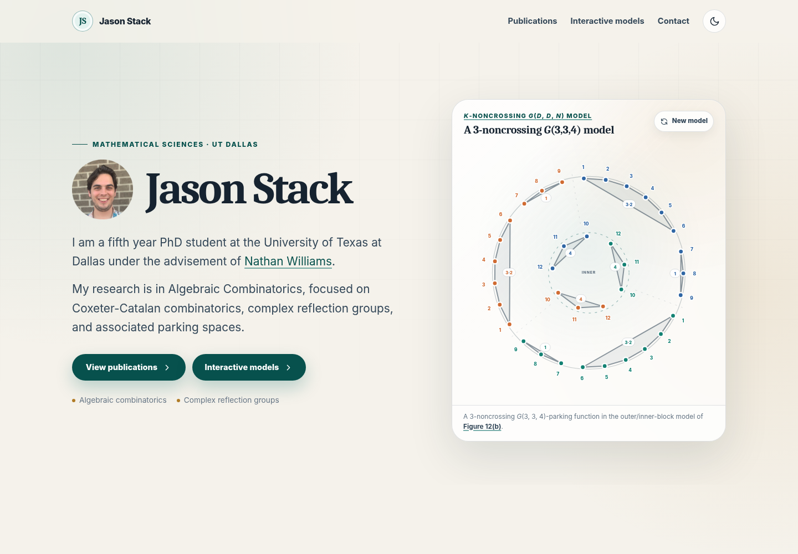

# Jason Stack — Research Website

A static, responsive research portfolio prepared for GitHub Pages.



It includes:

- a randomized `G(3,3,4)` Fuss parking-function model based on the outer/inner-block construction in Figure 12(b), with color-coded nodes and individual block-label numbers, and neutral block hulls;
- a two-paragraph introduction and a linked advisor name;
- selected publications: two published articles, two preprints, and one ongoing project;
- downloadable BibTeX;
- a footer CV button opening the supplied PDF in a new tab;
- a live embedded `G(d,1,n)` noncrossing multichain visualizer;
- email, affiliation, and LinkedIn contact links, plus a GitHub repository link;
- light and dark themes, responsive navigation, publication filters, and copyable citations.


## Files

```text
.
├── .nojekyll
├── index.html
├── publications.bib
├── README.md
├── site.webmanifest
├── assets/
│   ├── LinkedInProfPic.png
│   ├── favicon.svg
│   ├── site-preview.png
│   ├── site.js
│   └── styles.css
└── projects/
    ├── Gd1n_noncrossing_visualizer_withaction.html
    ├── gap3-parking-functions.html
    └── k-noncrossing-parking.gap
```
